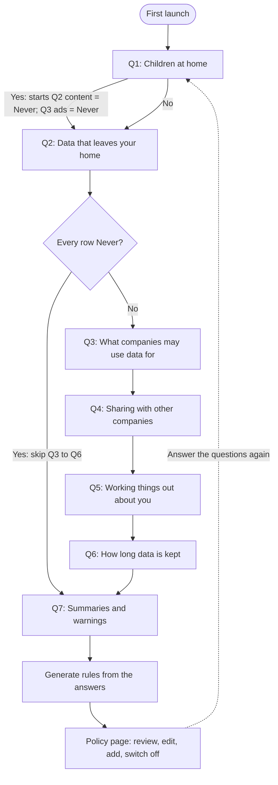

# Household privacy questions: decision tree

Version 0.1.0. Generated from `public/mock/questionnaire.json` by `tools/build_tree_doc.py`. The JSON is the machine-readable tree and the app reads it directly.

> **Status.** The questions are derived from factors studied in the cited papers. The wording, the branching and the mapping from answers to rules are this project's design and have not been user-tested.

## 1. What this does

On first launch the app asks a few questions. The answers are turned into a **household policy**: a list of rules, each saying **Never**, **Ask me first**, or **Allowed** for one kind of data flow. The person then reviews the rules and can change, switch off, delete or add any of them. Every device is compared against the household's current rules.

```
answers --(this tree)--> rules --(edited by the person)--> household policy --(compared with each flow)--> verdict
```

### Rule shape

Each rule has an effect (`dont_allow` | `ask` | `allow`), a scope, a title the person sees, an on/off switch, and where it came from. A scope names PPD core taxonomy terms. A field left out means "any".

```json
{
  "id": "q2_data.content",
  "effect": "dont_allow",
  "enabled": true,
  "scope": {
    "data_type": [
      "ppd:contentData"
    ],
    "handling_context": [
      "ppd:vendorContext",
      "ppd:thirdPartyContext"
    ]
  },
  "title": "Never send video, photos or sound out of my home",
  "origin": {
    "kind": "questionnaire",
    "question_id": "q2_data",
    "row_id": "content",
    "answer": "never"
  }
}
```

A flow matches a scope when each field the scope names has one of the listed values (checked against the flow's core term and its fine-grained term), and every listed constraint is present on the flow.

### Which rule wins

When several rules match one flow the stricter one wins: **Never > Ask me first > Allowed**.

| Order | What is checked | Verdict |
|---|---|---|
| 1 | The flow has no source yet (`needs_source`) | Can't tell |
| 2 | A matching **Never** rule | Conflicts with your rules |
| 3 | A matching **Ask me first** rule | Needs your decision |
| 4 | The flow declares a limit (stays on the device or in the home, or is kept only briefly) | With limits |
| 5 | A matching **Allowed** rule | Matches your rules |
| 6 | No rule matches and the flow leaves the home | Needs your decision |
| 7 | No rule matches and the flow stays in the home | Matches your rules |

The app never says a device complies. This comparison is a stand-in written for the front end; the real comparison belongs to the backend. How a person can control a flow (a setting, a setup step) is shown as a read-only line and never changes a verdict.

## 2. The tree



Branching rules in the JSON (`show_if`):

- **Q3** is shown when not (every row of Q2 is "never").
- **Q4** is shown when not (every row of Q2 is "never").
- **Q5** is shown when not (every row of Q2 is "never").
- **Q6** is shown when not (every row of Q2 is "never").

Answers are resolved in this order: question defaults, then prefills from earlier answers, then whatever the person chose. The person's choice always wins over a prefill.

## 3. Questions, answers and the rules they make

### Q1. Do children live in your home, or visit often?

*We only use this to start the next questions with stricter choices. You can change every one of them.*

- **Type:** single · **default:** none (the person has to pick)
- **Why we ask (shown to the person):** The expert study listed special handling of children's data as an item for the label's detailed layer.
- **Sources:** [Emami-Naeini et al., 2020](#naeini2020)
- **Design choice, not from the papers:** The papers do not test children's data as a factor. The expert study only lists it as a label item. Using "yes" to start the video and advertising choices on Never is this project's choice. Nothing is applied that the person cannot change.

| Answer | Rules made | Effect | Scope |
|---|---|---|---|
| Yes | none. Also starts Q2 “content” at Never, Q3 “ads” at Never. | | |
| No | none. | | |

### Q2. Which kinds of data should stay in your home?

*For each kind, choose what a device may do when the data would go to a company outside your home: the maker, its services, or other companies.*

- **Type:** matrix · **default:** ask
- **Why we ask (shown to the person):** Comfort depends on the kind of data. In a study of 1,007 people, biometric data and collection at home worried people most, while presence and room-temperature data were easier to accept. Experts also put the type of data and the sensors on the label's first layer.
- **Sources:** [Emami-Naeini et al., 2017](#naeini2017); [Emami-Naeini et al., 2020](#naeini2020)
- **Design choice, not from the papers:** The six rows group the PPD core data types (contentData, locationData, sensorData, identifierData + profileData, usageData, deviceAndNetworkData). The 2017 study varied four kinds of data (presence, video, specific position, biometric); the app's rows are broader. Biometrics are not asked separately because no flow in the four devices' data mentions biometric data. The scale is Never / Ask / OK, which is this project's mapping onto rule effects.

| Row | Never send → **Never** | Ask me → **Ask me first** | OK to send → **Allowed** | Scope |
|---|---|---|---|---|
| **Video, photos and sound**<br>Camera footage, microphone audio, voice commands. | Never send video, photos or sound out of my home | Ask me before video, photos or sound leave my home | Video, photos and sound may be sent to the company | `data = contentData; handled by = vendorContext or thirdPartyContext` |
| **Where you are**<br>Your phone's location, whether you are home or away. | Never send my location out of my home | Ask me before my location leaves my home | My location may be sent to the company | `data = locationData; handled by = vendorContext or thirdPartyContext` |
| **What sensors notice**<br>Someone being in the room, motion, room temperature. | Never send sensor readings out of my home | Ask me before sensor readings leave my home | Sensor readings may be sent to the company | `data = sensorData; handled by = vendorContext or thirdPartyContext` |
| **Who you are**<br>Your name, email, account, and the guests you invite. | Never send details about who I am out of my home | Ask me before details about who I am leave my home | Details about who I am may be sent to the company | `data = identifierData or profileData; handled by = vendorContext or thirdPartyContext` |
| **How you use your devices**<br>When you unlock the door, what you watch, which features you use. | Never send my usage history out of my home | Ask me before my usage history leaves my home | My usage history may be sent to the company | `data = usageData; handled by = vendorContext or thirdPartyContext` |
| **Device and network details**<br>Device logs, Wi-Fi information, device IDs. | Never send device and network details out of my home | Ask me before device and network details leave my home | Device and network details may be sent to the company | `data = deviceAndNetworkData; handled by = vendorContext or thirdPartyContext` |

### Q3. What may companies use your data for?

*This applies to data that has already left your home.*

- **Type:** matrix · **default:** ask
- **Shown when:** not (every row of Q2 is "never")
- **Why we ask (shown to the person):** Why data is used matters. People were more willing to allow collection for uses that benefit them. In the label studies, purpose was something consumers said mattered, and a purpose of "device function" was often not trusted on its own.
- **Sources:** [Emami-Naeini et al., 2017](#naeini2017); [Emami-Naeini et al., 2020](#naeini2020); [Emami-Naeini et al., 2021](#naeini2021)
- **Design choice, not from the papers:** The six rows are the PPD core purposes, reworded. The papers tested "device function" versus "monetization" style purposes, not these exact six.

| Row | Never → **Never** | Ask me → **Ask me first** | OK → **Allowed** | Scope |
|---|---|---|---|---|
| **Making a feature work**<br>Watching your camera when you are away, cloud backup, linking to Alexa or Google. | Never send my data to a company to make a feature work | Ask me when a feature needs to send my data to a company | Companies may use my data to make features work | `purpose = coreFunctionality; handled by = vendorContext or thirdPartyContext` |
| **Sending you alerts**<br>Push notifications and email alerts. | Companies may not use my data to send me alerts | Ask me before a company uses my data to send alerts | Companies may use my data to send me alerts | `purpose = communicationsAndNotifications; handled by = vendorContext or thirdPartyContext` |
| **Fixing problems and keeping devices running**<br>Error logs, crash reports, support requests. | Companies may not use my data for diagnostics | Ask me before a company uses my data for diagnostics | Companies may use my data to fix problems | `purpose = diagnosticsAndMaintenance; handled by = vendorContext or thirdPartyContext` |
| **Improving their products**<br>Usage statistics, research, measuring audiences. | Never use my data to improve products or measure audiences | Ask me before my data is used to improve products | Companies may use my data to improve their products | `purpose = analyticsAndImprovement; handled by = vendorContext or thirdPartyContext` |
| **Personalizing things for you**<br>Suggestions and settings that adapt to you. | Never use my data for personalization | Ask me before my data is used for personalization | Companies may use my data to personalize things for me | `purpose = personalization; handled by = vendorContext or thirdPartyContext` |
| **Advertising and marketing**<br>Ads, marketing, offers based on where you are. | Never use my data for advertising | Ask me before my data is used for advertising | My data may be used for advertising | `purpose = advertisingAndMarketing; handled by = vendorContext or thirdPartyContext` |

### Q4. May a device's maker pass your data to other companies?

*This includes selling it. Your smart-home app, like Alexa or Google, counts as another company.*

- **Type:** single · **default:** ask
- **Shown when:** not (every row of Q2 is "never")
- **Why we ask (shown to the person):** In the 2021 study, sharing and selling moved people the most. Learning that data is not shared with third parties had the strongest positive effect on willingness to buy, and data sold to third parties raised perceived risk the most. All 15 interviewed consumers were concerned about sharing or selling, and sharing lowered comfort in the 2017 study.
- **Sources:** [Emami-Naeini et al., 2017](#naeini2017); [Emami-Naeini et al., 2020](#naeini2020); [Emami-Naeini et al., 2021](#naeini2021)
- **Design choice, not from the papers:** The core PPD taxonomy has no "sold" value, so selling is folded into "other companies" and the question says so. The "only when a feature I use needs it" option is this project's wording for a rule that allows core functionality and notifications and blocks the rest.

| Answer | Rules made | Effect | Scope |
|---|---|---|---|
| Never | Never let a device's maker pass my data to other companies | Never | `handled by = thirdPartyContext` |
| Ask me each time | Ask me before my data goes to other companies | Ask me first | `handled by = thirdPartyContext` |
| Only when a feature I use needs it | My data may go to other companies when a feature I use needs it | Allowed | `purpose = coreFunctionality or communicationsAndNotifications; handled by = thirdPartyContext` |
|  | Never let other companies have my data for anything but a feature I use | Never | `purpose = analyticsAndImprovement or personalization or diagnosticsAndMaintenance or advertisingAndMarketing; handled by = thirdPartyContext` |

### Q5. May companies work out extra things about you from your data?

*For example, guessing when you are away, your daily routine, or what kind of viewer you are.*

- **Type:** single · **default:** ask
- **Shown when:** not (every row of Q2 is "never")
- **Why we ask (shown to the person):** Working out extra information about people lowered comfort in the 2017 study. Inference was also one of the attributes tested in 2021 and sits on the label's detailed layer.
- **Sources:** [Emami-Naeini et al., 2017](#naeini2017); [Emami-Naeini et al., 2020](#naeini2020); [Emami-Naeini et al., 2021](#naeini2021)
- **Design choice, not from the papers:** Maps to the PPD action "inference". Whether a flow counts as inference comes from the device's declaration, not from anything the person says.

| Answer | Rules made | Effect | Scope |
|---|---|---|---|
| Never | Never let companies work out extra things about me | Never | `handled by = vendorContext or thirdPartyContext; action = inference` |
| Ask me | Ask me before a company works out extra things about me | Ask me first | `handled by = vendorContext or thirdPartyContext; action = inference` |
| That's fine | Companies may work out extra things from my data | Allowed | `handled by = vendorContext or thirdPartyContext; action = inference` |

### Q6. How long may companies keep your data?

*We can only check this when a device says how long it keeps data.*

- **Type:** single · **default:** ask
- **Shown when:** not (every row of Q2 is "never")
- **Why we ask (shown to the person):** In 2017 only short retention (a week, or deleting right away) clearly raised comfort. In 2021, keeping no data in the cloud lowered perceived risk the most, and the authors recommended moving retention to the label's first layer.
- **Sources:** [Emami-Naeini et al., 2017](#naeini2017); [Emami-Naeini et al., 2021](#naeini2021)
- **Design choice, not from the papers:** A device is only in conflict when it says it keeps data indefinitely. "Not stated" is never treated as forever, so this question has no effect on devices that do not state retention. The papers also found short retention helped (a week; delete right away), which this single question does not separate.

| Answer | Rules made | Effect | Scope |
|---|---|---|---|
| Only briefly, never forever | Companies may not keep my data forever | Never | `handled by = vendorContext or thirdPartyContext; retention=indefinite` |
| Ask me | Ask me before a company keeps my data forever | Ask me first | `handled by = vendorContext or thirdPartyContext; retention=indefinite` |
| No limit | none. | | |

### Q7. How should we keep you posted?

*These are saved with your policy. The app does not send summaries or warnings yet.*

- **Type:** profile
- **Why we ask (shown to the person):** People were more likely to want a notice about practices they were uncomfortable with, and most wanted a monthly summary (63%, versus 23% daily, 8% yearly and 6% never). The 2022 label article describes a companion app where people set preferences for warnings.
- **Sources:** [Emami-Naeini et al., 2017](#naeini2017); [Emami-Naeini et al., 2022](#naeini2022)
- **Design choice, not from the papers:** Saved with the policy only. Nothing sends summaries or warnings yet.

- **A summary of what your devices do with your data:** Every day / Every month / Every year / Never (default: monthly)
- **Warn me when a device conflicts with my rules:** on / off (default: on)

These are stored as the policy's `profile` and make no rules.

## 4. Worked examples

**A. Children at home; "Never" to other companies; every other answer left on its default**

Questions asked: 7 (Q1, Q2, Q3, Q4, Q5, Q6, Q7). Rules made: 15.

| Effect | Rule |
|---|---|
| Never | Never send video, photos or sound out of my home |
| Never | Never use my data for advertising |
| Never | Never let a device's maker pass my data to other companies |
| Ask me first | Ask me before my location leaves my home |
| Ask me first | Ask me before sensor readings leave my home |
| Ask me first | Ask me before details about who I am leave my home |
| Ask me first | Ask me before my usage history leaves my home |
| Ask me first | Ask me before device and network details leave my home |
| Ask me first | Ask me when a feature needs to send my data to a company |
| Ask me first | Ask me before a company uses my data to send alerts |
| Ask me first | Ask me before a company uses my data for diagnostics |
| Ask me first | Ask me before my data is used to improve products |
| Ask me first | Ask me before my data is used for personalization |
| Ask me first | Ask me before a company works out extra things about me |
| Ask me first | Ask me before a company keeps my data forever |

**B. Every kind of data kept in the home (the short path)**

Questions asked: 3 (Q1, Q2, Q7). Rules made: 6.

| Effect | Rule |
|---|---|
| Never | Never send video, photos or sound out of my home |
| Never | Never send my location out of my home |
| Never | Never send sensor readings out of my home |
| Never | Never send details about who I am out of my home |
| Never | Never send my usage history out of my home |
| Never | Never send device and network details out of my home |

## 5. Sources

Links are the plain paper or DOI pages (the tracking parameters on the originally pasted links were removed).

<a id="naeini2017"></a>**Emami-Naeini et al., 2017.** Pardis Emami Naeini, Sruti Bhagavatula, Hana Habib, Martin Degeling, Lujo Bauer, Lorrie Cranor, and Norman Sadeh. 2017. Privacy Expectations and Preferences in an IoT World. In Proceedings of the Thirteenth Symposium on Usable Privacy and Security (SOUPS 2017), pp. 399-412. USENIX Association.  
[page](https://www.usenix.org/conference/soups2017/technical-sessions/presentation/naeini) · [PDF](https://www.usenix.org/system/files/conference/soups2017/soups2017-naeini.pdf) · used for: Q2, Q3, Q4, Q5, Q6, Q7

<a id="naeini2020"></a>**Emami-Naeini et al., 2020.** Pardis Emami-Naeini, Yuvraj Agarwal, Lorrie Faith Cranor, and Hanan Hibshi. 2020. Ask the Experts: What Should Be on an IoT Privacy and Security Label? IEEE Symposium on Security and Privacy (S&P 2020).  
[page](https://iotsecurityprivacy.org/research/AskTheExperts/) · [PDF](https://arxiv.org/pdf/2002.04631) · used for: Q1, Q2, Q3, Q4, Q5

<a id="naeini2021"></a>**Emami-Naeini et al., 2021.** Pardis Emami-Naeini, Janarth Dheenadhayalan, Yuvraj Agarwal, and Lorrie Faith Cranor. 2021. Which Privacy and Security Attributes Most Impact Consumers' Risk Perception and Willingness to Purchase IoT Devices? IEEE Symposium on Security and Privacy (S&P 2021).  
[page](https://ieeexplore.ieee.org/stamp/stamp.jsp?arnumber=9519463) · [PDF](https://par.nsf.gov/servlets/purl/10316411) · used for: Q3, Q4, Q5, Q6

<a id="naeini2022"></a>**Emami-Naeini et al., 2022.** Pardis Emami-Naeini, Janarth Dheenadhayalan, Yuvraj Agarwal, and Lorrie Faith Cranor. 2022. An Informative Security and Privacy "Nutrition" Label for Internet of Things Devices. IEEE Security & Privacy, March/April 2022, pp. 31-39. doi:10.1109/MSEC.2021.3132398.  
[page](https://doi.org/10.1109/MSEC.2021.3132398) · [PDF](https://inspire.cs.duke.edu/publications/sp21/sp21-mag.pdf) · used for: Q7

### What each paper supports

**Emami-Naeini et al., 2017 (SOUPS).** 1,007 people (1,014 completed; 7 removed) each rated 14 of 380 scenarios. Eight factors were varied: location, kind of data, device type, user benefit, purpose, retention, whether the data is shared, and whether it is inferred. Findings used here: home was the only location that lowered comfort; biometric data was least comfortable; only short retention clearly raised comfort; sharing and inference lowered comfort; benefit to the user and specific purposes raised willingness to allow. Preferred summary frequency: monthly 63%, daily 23%, yearly 8%, never 6%.

**Emami-Naeini et al., 2020 (S&P).** A three-round Delphi study with 22 experts, then 15 consumer interviews, about what an IoT privacy and security label should show. Privacy items on the first layer included the kind of data, the sensors, the purpose, where data is stored, who it is shared with and who it is sold to. Retention time, inference, linkage, children's data, user controls and collection frequency were on the second layer. All 15 consumers were worried about sharing or selling.

**Emami-Naeini et al., 2021 (S&P).** 1,371 people judged labels built from 16 attribute and value pairs. Data sold to third parties raised perceived risk the most; no cloud retention lowered it the most; "not shared with third parties" had the strongest positive effect on willingness to buy; a purpose of "device function" was often not trusted. The authors recommended moving retention to the first layer and explaining purpose.

**Emami-Naeini et al., 2022 (IEEE Security & Privacy).** A magazine article that summarizes the label work: 24 consumer and 22 expert interviews, 47 information items, a label generator, and a companion app where people set preferences for warnings. The companion app is the same idea this app builds on: the person states preferences first, and warnings follow from them.

### Corrections to the notes the question list was based on

The list pasted into the request had these errors. They are corrected above and in the JSON:

- **2017 study:** notification and comfort were *outcome* questions, not factors that were varied. The eight varied factors are listed above.
- **2017 study, prediction accuracy:** the abstract says "up to 86%". The tables show about 81% (comfort) and 79% (allow or deny), and Section 6.3 reports 88% for three observed decisions predicting eleven. These do not agree, so no accuracy figure is quoted in the app.
- **2021 paper:** the authors are Emami-Naeini, Dheenadhayalan, Agarwal and Cranor (from the paper's own PDF). One publication page lists different authors, which looks wrong. The venue (IEEE S&P 2021) is taken from the authors' page; the PDF text I could read does not print it.
- **2022 paper:** it is an IEEE Security & Privacy *magazine* article (March/April 2022, pp. 31 to 39, doi 10.1109/MSEC.2021.3132398). The "2021 IEEE Symposium" text on the PDF is a running header.
- Every link carried a `utm_source=chatgpt.com` tracking parameter. Removed.

## 6. Limits and open questions

- **Derived, not validated.** The questions come from factors the papers studied. The wording, the order, the branching and the answer-to-rule mapping have not been tested with people. A short pilot would show whether the matrix questions are understood.
- **Biometrics.** The 2017 study found biometric data the most uncomfortable. It is not a separate row because no flow in the four devices' data mentions biometric data. Add a row if a device declares one.
- **Selling.** The core PPD taxonomy cannot express "sold". Q4 covers it as "other companies" and says so.
- **Retention.** Q6 only bites when a device states that it keeps data forever. Silence is not a conflict.
- **Children.** Q1 only changes the starting choices. It is not a finding of the papers.
- **Rule scopes use core PPD terms.** Whether a PPD household policy can express these scopes this way is a question for the sponsor (Daniel Smullen).
- **Placeholder engine.** The front end evaluates rules itself to make the demo work. The backend should own the comparison.
- **Summaries and warnings (Q7)** are saved with the policy but nothing sends them yet.

